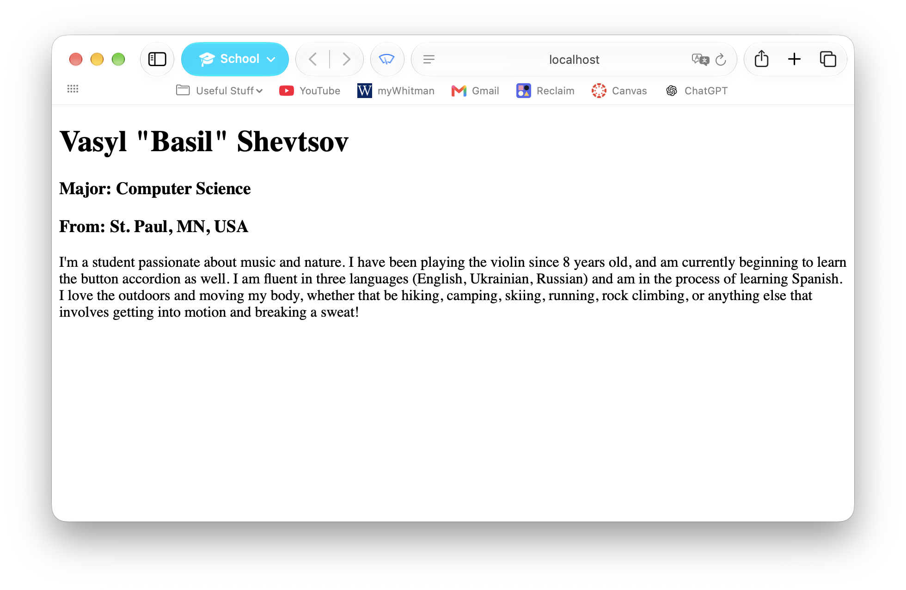

Vasyl "Basil" Shevtsov

# Answers to the lab 8 questions:

## 4. Ask yourself what is the behavior of these files?
SimpleWebServer.java sets up and starts an HTTP server on port 8000. Then is sets up a request handler by connecting the root path ( / ) to a SimpleHandler object, which handles incoming requests. After starting the server it prints a message to the console and shows the address http://localhost:8000

SimpleHandler.java handles requests by reading and returning the contents of index.html (which is located in thw working directory of this program). It will always serve the same file no matter what the requested URL path is. If the file exists, it sends a 200 OK resopnse with the file's contents. If the file is missing, it returns a 404 "File not found" response. If an exception occurs it attempts to return a 500 "Server error" response.

## 6. Ask yourself why this happened?
When I type http://localhost:8000 into my browser, the browser sends an HTTP GET request for the root path. The running server that was made by SimpleWebServer.java receives the request and passes it to SimpleHandler because the requested path is /. The hadler then checks if index.html exists, reads the contents, and sends them back to the browser with a 200 OK status. The browswer then interprets the HTML and renders the webpage displaying it for us to see.
